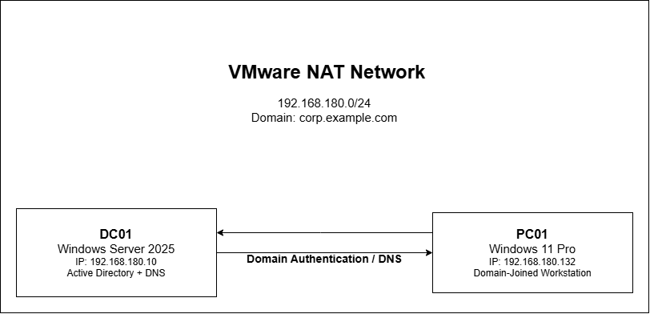

# Windows Server 2025 Active Directory & Cybersecurity Home Lab

## Project Overview

I built this hands-on IT and cybersecurity lab using VMware, Windows Server 2025, and Windows 11.

My goal was to learn how to manage a Windows domain environment and protect company resources using real-world IT administration and cybersecurity practices.

In this project, I configured Active Directory, DNS, domain users, security groups, Group Policy, and shared folder permissions. I also practiced account lockout investigations, Windows Event Viewer monitoring, and server backup and recovery planning.

This project helped me improve my technical skills in Windows Server administration, troubleshooting, access control, and system security.

## Technologies and Tools Used

| Technology | Purpose |
|---|---|
| VMware Workstation | Created and managed virtual machines |
| Windows Server 2025 | Configured the domain controller (DC01) |
| Windows 11 Pro | Used as a domain-joined workstation (PC01) |
| Active Directory Domain Services (AD DS) | Managed users, groups, and computers |
| DNS Server | Provided domain name resolution |
| Group Policy Management | Configured workstation security policies |
| NTFS and SMB Permissions | Controlled access to shared folders |
| Windows Event Viewer | Investigated failed logins and account lockouts |
| PowerShell | Verified configurations and investigated security events |
| Windows Server Backup | Created and verified a System State backup |

### Lab Environment

- ****Domain:**** corp.example.com

- ****Domain Controller:**** DC01 — Windows Server 2025

- ****Client Computer:**** PC01 — Windows 11 Pro

- ****Network:**** VMware NAT

- ****DC01 IP Address:**** 192.168.180.10

- ****PC01 IP Address:**** 192.168.180.132

## Active Directory Configuration

I installed and configured Active Directory Domain Services (AD DS) on Windows Server 2025 and created a domain named `corp.example.com`.

I organized the domain to simulate a small company's IT environment.

### Users and Organizational Units

I created and managed the following:

- ****IT OU:**** Contains IT department users.

- ****HR OU:**** Contains Human Resources users.

- ****Workstations OU:**** Contains domain-joined computers.

- ****James Wilson (`jwilson`):**** IT department user.

- ****Sarah Johnson (`sjohnson`):**** HR department user.

- ****IT-Support:**** Security group for IT employees.

- ****HR-Support:**** Security group for HR employees.

### Shared Folder Access Control

I configured two shared folders on DC01:

- `\\\DC01\IT-Shared`

- `\\\DC01\HR-Shared`

I used Active Directory security groups, NTFS permissions, and share permissions to control access.

I tested the configuration to confirm that:

- James could access the IT shared folder but not the HR shared folder.

- Sarah could access the HR shared folder but not the IT shared folder.

This helped me understand ****role-based access control (RBAC)**** and the ****principle of least privilege****, where users receive only the access they need for their jobs.

### Screenshots


## Group Policy Security Configuration

I used Group Policy Management on Windows Server 2025 to configure security settings for computers connected to my Active Directory domain.

### 1. Windows Defender Security Policy

I created a Group Policy Object named ****GPO - Workstation Defender Security****.

I linked this policy to the ****Workstations OU****, which contains my Windows 11 computer (PC01).

I used the `gpresult` command on PC01 to verify that the policy was applied.

### 2. Automatic Screen-Lock Policy

I created another Group Policy Object named ****GPO - Employee Screen Lock****.

I configured the machine inactivity limit to ****300 seconds (5 minutes)****.

I tested this policy to confirm that Windows automatically locks the workstation after five minutes of inactivity.

### What I Learned

This part of the project helped me understand how IT administrators use Group Policy to manage security settings across company computers.

I also learned how to verify that a policy is applied to the correct computers instead of assuming that it works.

### Screenshots


## Security Monitoring and Account Lockout Investigation

I configured and tested account security policies in my Windows Server 2025 Active Directory environment.

### Account Lockout Policy

I configured the following settings:

- ****Account lockout threshold:**** 5 failed login attempts

- ****Account lockout duration:**** 15 minutes

- ****Reset account lockout counter:**** 15 minutes

I tested the policy by entering an incorrect password five times for the `jwilson` account on PC01.

I used PowerShell to confirm that the account was locked:

```powershell

Get-ADUser -Identity jwilson -Properties LockedOut | Select-Object Name, LockedOut

```

After verifying the lockout, I unlocked the account using:

```powershell

Unlock-ADAccount -Identity jwilson

```

### Windows Security Event Investigation

I used Windows Event Viewer to investigate authentication failures.

****Event ID 4740 — User Account Locked Out****

On DC01, I found Event ID 4740 showing that the `jwilson` account had been locked out. The event identified PC01 as the computer associated with the lockout.

****Event ID 4625 — Failed Logon****

On PC01, I investigated Event ID 4625, which recorded an unsuccessful login attempt for the `jwilson` account.

I reviewed the account information, logon type, and failure status to understand why the authentication failed.

### What I Learned

This exercise helped me understand how security administrators investigate suspicious login activity, identify affected accounts, and use Windows security logs during troubleshooting.

I also learned how account lockout policies can help reduce password-guessing attacks.

### Screenshots


## Windows Server Backup and Recovery

I configured Windows Server Backup on my Windows Server 2025 domain controller (DC01) to protect important system information.

### Backup Configuration

I added a second 30 GB virtual hard disk in VMware and configured it as a backup drive.

- ****Backup destination:**** Server-Backup (E:)

- ****Backup type:**** System State

- ****Backup tool:**** Windows Server Backup

- ****Backup result:**** Completed successfully

- ****Data transferred:**** 12.23 GB

### Backup Verification

After completing the backup, I used PowerShell to verify that Windows Server recognized it.

```powershell

wbadmin get versions -backupTarget:E:

```

I also inspected the recoverable items using:

```powershell

wbadmin get items -version:11/08/2026-07:25 -backupTarget:E:

```

The backup included important system components such as Active Directory, the Windows Registry, and SYSVOL.

### Recovery Planning

I opened the Windows Server Backup Recovery Wizard and confirmed that the System State recovery option was available.

I reviewed the recovery options without performing an actual restoration because I wanted to keep my working domain controller unchanged.

This verification confirmed that the backup was recognized and its contents could be listed. A full recovery test was not performed.

### What I Learned

I learned how to create a System State backup, verify its contents, and review recovery procedures.

I also learned that a backup stored on a separate virtual disk is useful for practice, but a production environment needs additional backup protection, including copies stored outside the original host.

### Screenshots


## Network Configuration

I created a virtual network using VMware Workstation to connect my Windows Server 2025 domain controller and Windows 11 workstation.

I used VMware NAT networking so both virtual machines could communicate with each other.

### Network Details

| Device | Operating System | IP Address | Role |
|---|---|---|---|
| DC01 | Windows Server 2025 | 192.168.180.10 | Domain Controller and DNS Server |
| PC01 | Windows 11 Pro | 192.168.180.132 | Domain-Joined Workstation |

****Active Directory Domain:**** `corp.example.com`

### Network Testing

I configured PC01 to use DC01 as its DNS server so the workstation could locate Active Directory services.

I successfully joined PC01 to the domain and verified its domain membership.

### What I Learned

This part of the project helped me understand how DNS supports Active Directory, how computers communicate on a virtual network, and why correct IP and DNS settings are important in a Windows domain environment.

### Screenshots


### Network Architecture Diagram

The diagram below shows my VMware NAT network, including the Windows Server 2025 domain controller (DC01) and Windows 11 workstation (PC01).


